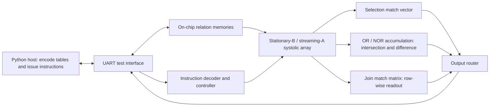

# SAFRDO: A Systolic Array Accelerator for Relational Database Operations

A final-year FPGA project at **Kwame Nkrumah University of Science and Technology (KNUST)**, supervised by **Prof. Kwame Osei Boateng**.

SAFRDO implements **selection, equi-join, intersection, and difference** on a shared systolic array. A runtime instruction selects the operation and comparison columns without rebuilding the FPGA design. The project explores how spatial parallelism and tuple reuse can accelerate relational comparisons, and how result storage affects timing and scalability.

The design is written in **SystemVerilog**, simulated with **Questa**, and implemented using **Xilinx Vivado** for a **Digilent Nexys A7 with an Artix-7 XC7A50T**. The evaluated configuration contains **200 processing elements: 50 rows × 4 attributes**, with 8-bit encoded attributes.

## Architecture



Relation B is loaded into the array and held stationary. Relation A streams through the rows, allowing each A tuple to be compared against resident B tuples. Attribute equality results propagate through a masked match chain; columns excluded by the instruction do not affect the comparison.

| Operation | Result |
| --- | --- |
| Selection | B rows whose selected attribute equals an immediate value |
| Equi-join | Matching A/B row-index pairs over the enabled columns |
| Intersection | A rows with a matching B row |
| Difference | A rows with no matching B row |

The host uses a shared dictionary per column to encode text values into 8-bit identifiers. The FPGA compares these identifiers; it does not process arbitrary strings or SQL. Selection currently supports one attribute per instruction. Intersection and difference use row-membership semantics; this is not a complete SQL engine.

## Engineering highlight: join-result readout

The join collector stores an N × N match matrix. An earlier design selected one bit at a time and swept the matrix in a dedicated drain phase. The final design exposes an entire B-row match vector per read, which the host expands into A/B index pairs.

The project evaluation reports:

- Removal of the join-specific drain phase, reducing compute latency from approximately 2,650 to 154 cycles for the 50-row configuration.
- An increase in the timing-derived frequency estimate from 101.1 to 115.6 MHz.
- Removal of the earlier 255-pair output cap by transmitting match vectors instead of a capped pair list.
- A tradeoff in collector resources: LUT usage increased from 686 to 903, while register usage remained at 2,550.

Result transfer still takes place after computation. The compute-latency reduction is not an equivalent reduction in end-to-end host latency.

## Reported implementation results

The following figures are recorded in the project evaluation for the 50-row XC7A50T implementation.

| Resource | Accelerator core | Whole design, including UART |
| --- | ---: | ---: |
| LUTs | 2,017 (6.2% of device) | 2,221 |
| Flip-flops | 6,301 | 6,667 |
| Slices | 1,486 | 1,545 |
| Block RAM tiles | 2 | 2 |
| DSP blocks | 0 | 0 |

The reported implementation meets a **100 MHz clock constraint**, with **+1.350 ns setup slack** and **+0.017 ns hold slack**. The approximately **115.6 MHz** figure is an estimate derived from setup slack at that constraint, rather than a separately demonstrated board operating frequency.

For two full 50-row relations, the documented compute schedule is approximately **154 cycles**: **1.54 µs at 100 MHz**, or an estimated **1.33 µs at 115.6 MHz**. These figures exclude host encoding, UART transfers, and host-side result expansion.

### Software comparison and measurement scope

The compiled-C baseline uses linear scans and nested-loop comparisons, built with `gcc -O2`. The report records five-run averages on an Intel Core i7-5600U. It reports compute-phase speedups of approximately 4.9× for intersection, 6.3× for difference, 8.0× for a one-column join, and 14.2× for a two-column join, using the estimated 1.33 µs FPGA time. Selection is slower on the accelerator at this scale (approximately 0.2×).

These are comparisons against this specific brute-force baseline, **not against an optimized database engine, hash join, or indexed implementation**. The C program calculates FPGA latency from configured cycle and timing parameters; it does not measure FPGA elapsed time. The figures are historical project results, not results regenerated by this README.

## Source guide

The main evaluated implementation is in [`structural/`](structural/).

| Files | Purpose |
| --- | --- |
| [`safrdo_top.sv`](structural/safrdo_top.sv), [`safrdo_controller.sv`](structural/safrdo_controller.sv) | Accelerator integration and execution sequencing |
| [`safrdo_datapath.sv`](structural/safrdo_datapath.sv), [`pe_array_2d.sv`](structural/pe_array_2d.sv), [`pe_row.sv`](structural/pe_row.sv), [`top_PE.sv`](structural/top_PE.sv) | Systolic datapath and processing elements |
| [`stagger_module.sv`](structural/stagger_module.sv) | Attribute and valid-signal alignment |
| [`accumulation_array_struct.sv`](structural/accumulation_array_struct.sv), [`join_collector.sv`](structural/join_collector.sv) | Membership reduction and join-result storage |
| [`safrdo_uart_bridge.sv`](structural/safrdo_uart_bridge.sv), [`uart_rx.sv`](structural/uart_rx.sv), [`uart_tx.sv`](structural/uart_tx.sv) | Board test interface |
| [`host_script_text.py`](structural/host_script_text.py) | Text encoding, board communication, and readable results |
| [`cpu_baseline.c`](structural/cpu_baseline.c) | Compiled software reference and timing harness |
| `structural/tb_*.sv` | Component and integration testbenches |
| [`structural_scaled/`](structural_scaled/) | 100-row variant used in the scalability study |

Start with `structural/` when exploring the evaluated system. The `structural_scaled/` directory contains the scaling-study variant.

## Running the host and software baseline

### FPGA host

Requires Python 3, `pyserial`, and a board programmed with the matching design.

```powershell
py -m pip install pyserial
cd structural
py host_script_text.py
```

Set `COM_PORT` in the host script to the board's serial port before running. The default configuration uses **115200 baud**, **50 rows**, and **4 columns**. Keep these settings consistent with the programmed RTL. Run from `structural/` so the sample CSV files can be found.

### Compiled-C baseline

With GCC available on your PATH:

```powershell
cd structural
gcc -O2 -o cpu_baseline.exe cpu_baseline.c
.\cpu_baseline.exe
```

The program loads `table_A_text.csv` and `table_B_text.csv`, prints software result counts, and times the reference operations. Its FPGA cycle/frequency constants must match the hardware configuration being compared.

### Hardware verification and builds

The project includes component and integration testbenches, and the report describes simulation and board checks for all four operations. The repository does not yet provide a complete, single-command simulation or Vivado build flow. Reproducing the board implementation requires the appropriate source set, device configuration, clock and pin constraints, and tool setup.

For the included 50-row text datasets, the documented reference results are:

| Query | Expected result |
| --- | ---: |
| Selection: City = Accra on B | 5 rows |
| Full-row intersection | 8 A rows |
| Full-row equi-join | 8 pairs |
| Equi-join on City | 162 pairs |

## Limitations and future work

- **Fixed on-chip capacity:** the evaluated array supports up to 50 rows per relation. Larger datasets require tiling or a larger implementation.
- **Quadratic join storage:** the dense N × N collector limits scaling even when actual matches are sparse. Sparse storage with backpressure is a future direction.
- **Slow host interface:** UART supports functional demonstration; it limits end-to-end throughput. A faster interface would be needed for deployment.
- **Restricted data model:** four 8-bit encoded attributes and equality predicates in the evaluated configuration; at most 255 distinct encoded values per column, with zero reserved for padding.
- **Evaluation scope:** small on-chip datasets demonstrate the design and its tradeoffs. Large-scale memory-system benefits and performance against optimized software remain to be evaluated.
- **Reproducibility:** automated regression and complete FPGA build packaging remain future repository improvements.

## Background and sample data

The dataflow builds on the **Kung–Lehman systolic architecture for relational database operations**. This project studies its FPGA implementation, runtime selection of four operations, and result-handling tradeoffs. The architecture and evaluation descriptions above summarize the final-year project; report drafts and internal working notes are excluded from this source release.

Names and phone fields in the text CSV examples have been replaced with consistent synthetic labels while preserving equality relationships and match counts.
